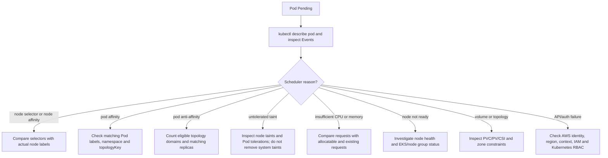

# Troubleshooting challenges and decision tree

## Pending Pod decision tree


## Five challenges

### Challenge 1 — nodeSelector mismatch
**Symptom:** `selector-demo` is Pending with a message similar to `didn't match Pod's node affinity/selector`.

**Investigate:**
```bash
kubectl -n scheduling-demo describe pod selector-demo
kubectl get nodes --show-labels
```
**Likely fix:** In an isolated lab only, add the exact scoped label `training.example.com/workload=demo` to an approved lab node, or remove/change the selector in a lab copy. Do not change operational labels on shared nodes.

### Challenge 2 — required Pod affinity mismatch
**Symptom:** frontend-affinity remains Pending.

**Investigate:**
```bash
kubectl -n scheduling-demo get pods --show-labels -o wide
kubectl -n scheduling-demo describe pod -l app=frontend-affinity
```
**Likely fix:** Ensure the backend Pod exists, is schedulable, has label `app=backend`, is in `scheduling-demo`, and that the topology key exists on nodes. This lab uses same-hostname affinity.

### Challenge 3 — required anti-affinity with three replicas
**Symptom:** third `spread-demo` replica remains Pending.

**Investigate:**
```bash
kubectl -n scheduling-demo get pods -o wide
kubectl -n scheduling-demo describe pod <pending-pod>
kubectl -n scheduling-demo get events --sort-by=.lastTimestamp
```
**Likely fix:** Reduce replicas to two, add a third eligible node, or use preferred anti-affinity in a copy. Do not promise separation if resource limits or other constraints prevent it.

### Challenge 4 — untolerated taint
**Symptom:** event reports an untolerated taint.

**Investigate:**
```bash
kubectl get nodes -o custom-columns=NAME:.metadata.name,TAINTS:.spec.taints
kubectl -n scheduling-demo describe pod <pod>
```
**Likely fix:** If this is a deliberately tainted dedicated lab node, add the exact matching toleration and optionally a selector to target it. Never remove a pre-existing/system taint to make a classroom demo work.

### Challenge 5 — EKS access or node readiness
**Symptom:** AWS `AccessDenied`, kubectl authentication failure, API unreachable, or worker node NotReady.

**Investigate:**
```bash
aws sts get-caller-identity
aws configure get region
kubectl config current-context
kubectl get --raw=/readyz
kubectl get nodes -o wide
aws eks describe-cluster --name "$EKS_CLUSTER_NAME" --region "$AWS_REGION"
```
**Likely fix:** Correct the profile/region/context, restore network access, and ask the cluster administrator to confirm EKS access entry/aws-auth configuration and Kubernetes RBAC. Node readiness requires separate EKS/EC2/kubelet/network investigation. IAM authentication, Kubernetes authorization, networking, node health and scheduler placement are separate concerns.

## Other common EKS issues
- **Wrong AWS profile/region:** use `aws sts get-caller-identity`, `aws configure list`, and explicit `--profile`/`--region`.
- **Wrong kubeconfig:** `kubectl config get-contexts`; select the verified context. `aws eks update-kubeconfig --name "$EKS_CLUSTER_NAME" --region "$AWS_REGION"` updates local kubeconfig only.
- **Insufficient resources:** compare Pod requests to node allocatable and current requests; `kubectl top nodes` requires Metrics Server and shows usage, not necessarily scheduler reservations.
- **Missing zone label:** inspect `kubectl get nodes -L topology.kubernetes.io/zone`. Do not assume nodes occupy separate AZs.
- **Managed node group interaction:** `aws eks list-nodegroups` only lists managed node groups. Check node group status/scaling and the actual Node objects; do not change managed node group configuration during this lab.
- **Unexpected node placement:** inspect all hard constraints first, then preferences, taints, resources and topology. Preferred rules do not guarantee a particular node.
